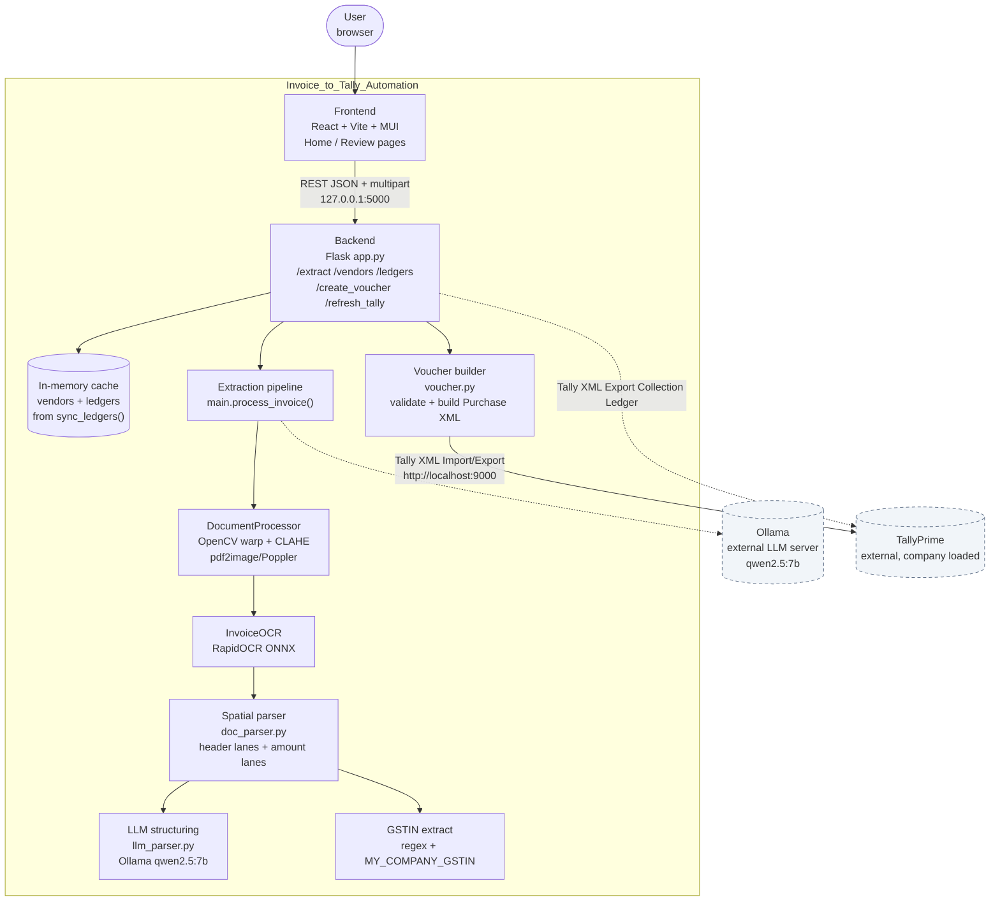

# Invoice to Tally Automation

Turn vendor invoices (PDF / photo) into reviewed TallyPrime purchase vouchers.

Upload an invoice in the web UI, get OCR + spatially-parsed line items corrected by a local LLM,
match the vendor/GST ledgers synced from Tally, group items under purchase account heads,
configure CGST/SGST vs IGST, preview the journal, and import the voucher into TallyPrime
via its XML API. A human reviews everything before anything is posted.


## Key capabilities

- **Invoice upload and extraction** — `POST /extract` accepts a PDF, PNG, or JPG (`invoice` multipart field),
  runs perspective correction + contrast enhancement, then RapidOCR, and returns
  `vendor_gstin`, `buyer_gstin`, and `extracted_line_items`.
- **Photo-tolerant preprocessing** — `DocumentProcessor` tries OpenCV contour-based perspective warp
  (bilateral filter, Otsu + Canny, 4-corner check) and falls back to treating the input as a clean
  scan; output is CLAHE-enhanced grayscale resized to a fixed OCR width.
- **Spatial table parser** — `doc_parser.extract_raw_line_lanes` finds the header band by Y-clustering
  (`DESCRIPTION`, `HSN/SAC`, `QTY`, `RATE`, `AMOUNT`, …), cuts off at `TOTAL`/`CGST`/`SGST`/`ROUND` rows,
  anchors line-item rows on right-side `NNN.NN` amount tokens, and pre-filters tax/ledger rows
  (`CGST`, `SGST`, `IGST`, `TOTAL`, `FREIGHT`, …) before mapping cells to the nearest header column.
- **Local LLM row correction** — `llm_parser.structure_lines_with_llm` sends each pre-mapped row to
  Ollama (`qwen2.5:7b`, temperature 0) to fix column mistakes and return
  `serial_no, description, hsn, quantity, unit, rate, discount_percent, amount`.
- **Tally master sync** — `tally.sync_ledgers` exports the Tally `Ledger` collection over
  `http://localhost:9000` (fetches `Name, Parent, MasterID, GUID, PartyGSTIN`), splits ledgers under
  `Sundry Creditors` into a vendor list, and caches both in memory. `GET /ledgers` excludes
  `Sundry Creditors` entries; `POST /refresh_tally` re-syncs on demand.
- **Review workflow** — the Review page shows the source document alongside editable invoice details,
  an ungrouped-items table, item groups with account-head assignment, per-group tax recalculation,
  a CGST+SGST / IGST ledger configuration with fuzzy auto-suggestion, a totals summary, and a
  voucher preview dialog with client-side validation.
- **Validated voucher import** — `POST /create_voucher` validates invoice number/date, vendor name + GUID,
  per-group account head/items/total, and required GST ledgers per tax mode; checks
  `sum(group totals) == summary.grandTotal` within 0.01; then posts a Tally `Purchase` voucher
  (`Import Data` XML with `SVCURRENTCOMPANY`) and returns Tally's `CREATED / ALTERED / ERRORS / LINEERROR` result.
- **OCR-tolerant vendor lookup helpers** — `lookup.py` provides GSTIN normalization, an OCR-confusion-aware
  similarity score (`0/O`, `1/I/L`, `5/S`, …), exact-plus-fuzzy `find_vendor_by_gstin`, and RapidFuzz
  name search. Note: `app.py` imports these helpers but no route currently calls them.

## Architecture



The diagram source lives in [`docs/architecture.mmd`](docs/architecture.mmd).

**Request flow:**

1. User uploads a PDF/image on `Home` → `POST /extract` (multipart, field `invoice`).
2. `process_invoice()` runs document enhancement → RapidOCR → spatial lane parsing → per-row
   Ollama correction → GSTIN split, and returns the ledger-ready JSON.
3. `Review` loads `GET /vendors` + `GET /ledgers`, lets the user verify the vendor, group items,
   assign purchase account heads, set tax mode/rates/ledgers, and preview the debit/credit journal.
4. `POST /create_voucher` validates and converts the reviewed voucher to Tally Purchase XML,
   posts it to TallyPrime at `localhost:9000`, and surfaces created/altered/error counts.

External systems (dashed): **TallyPrime** (XML over HTTP) and **Ollama** (chat API). Everything else
is owned by this repo. There is no database, queue, worker, or auth layer — state is the
in-memory Tally master cache plus React `InvoiceContext` on the client.

## Tech stack

| Layer             | Technology (verified)                                                                                                                                     |
| ----------------- | --------------------------------------------------------------------------------------------------------------------------------------------------------- |
| Backend           | Python, Flask 3.1.0, flask-cors 6.0.5                                                                                                                     |
| Image / PDF       | OpenCV (`cv2`), NumPy, `pdf2image` + Poppler, Pillow (transitive)                                                                                         |
| OCR               | `rapidocr_onnxruntime` (`RapidOCR`)                                                                                                                       |
| Parsing / LLM     | stdlib `re`, `ollama` Python client, model `qwen2.5:7b`                                                                                                   |
| Vendor matching   | `rapidfuzz` (`process`, `fuzz.WRatio`)                                                                                                                    |
| Tally integration | `requests` + `xml.etree.ElementTree`, Tally XML API at `http://localhost:9000`                                                                            |
| Config            | `python-dotenv` (`.env`: `MY_COMPANY_GSTIN`, `CURRENT_COMPANY`)                                                                                           |
| Frontend          | React 19.2.7, react-dom, react-router-dom 7.18, axios 1.18, MUI 9 (`@mui/material`, `@mui/icons-material`, `@emotion/*`), react-dropzone 15, react-pdf 10 |
| Tooling           | Vite 8, ESLint 10, `vite.config.js`, `eslint.config.js`                                                                                                   |

> `requirements.txt` is curated to the modules `backend/` actually imports. Two prerequisites
> are not pip-installable: the Poppler binary for `pdf2image` (see Prerequisites) and an Ollama
> server with the `qwen2.5:7b` model pulled.

## Project structure

```text
Invoice_to_Tally_Automation/
├── backend/
│   ├── app.py                 # Flask API: /, /extract, /vendors, /ledgers, /create_voucher, /refresh_tally
│   ├── main.py                # process_invoice() pipeline orchestration; MY_COMPANY_GSTIN
│   ├── document_processor.py  # PDF/image load, doc-corner warp, CLAHE post-processing
│   ├── doc_ocr.py             # RapidOCR wrapper (layout_data + timing breakdown)
│   ├── doc_parser.py          # Header/amount lane detection, GSTIN regex, amount sanitizing
│   ├── llm_parser.py          # Ollama per-row correction (qwen2.5:7b, temperature 0)
│   ├── tally.py               # Tally XML: sync_ledgers, get_current_company, post_xml_to_tally
│   ├── voucher.py             # Purchase-voucher validation + XML builder; CURRENT_COMPANY
│   ├── lookup.py              # GSTIN similarity + RapidFuzz vendor search helpers
│   └── uploads/               # Local upload directory (git-ignored; created at runtime if missing)
├── frontend/
│   ├── package.json           # react/axios/mui/dropzone/pdf-router deps; dev/build/lint/preview scripts
│   ├── vite.config.js         # Vite + @vitejs/plugin-react
│   ├── src/
│   │   ├── main.jsx           # BrowserRouter + InvoiceProvider bootstrap
│   │   ├── App.jsx            # Routes: / (Home), /review (Review)
│   │   ├── api/axios.jsx      # Alt axios client (baseURL localhost:5000)
│   │   ├── services/api.js    # Used client: extractInvoice, getVendors, getLedgers, refreshTally, createVoucher
│   │   ├── services/invoiceService.jsx  # Duplicate extractInvoice helper (not used by pages)
│   │   ├── context/InvoiceContext.jsx   # invoice/vendor/tax/groups + vendors/ledgers state
│   │   ├── pages/Home.jsx     # Upload → /extract → seed context → /review
│   │   ├── pages/Review.jsx   # Tally sync, GST ledger auto-suggest, groups/tax/summary layout
│   │   └── components/
│   │       ├── UploadCard.jsx # react-dropzone for .pdf/.png/.jpg/.jpeg
│   │       └── review/        # InvoicePreview, InvoiceDetails, ItemTable, GroupCard,
│   │                          # CreateGroupDialog, TaxConfig, SummaryCard,
│   │                          # VoucherPreviewDialog, AccountHeadAutocomplete, LeftPanel
├── docs/
│   └── architecture.mmd       # Mermaid source for the diagram above
└── requirements.txt           # Python deps, curated to backend imports
```

## Prerequisites and setup

You need all four of these running/locally available:

- **Python 3.x** (a `__pycache__` in the repo shows CPython 3.13; no version pin is declared)
- **Node.js + npm** (for the Vite frontend)
- **TallyPrime** on the same machine with your company loaded and its XML server listening on
  `http://localhost:9000` (hardcoded in `backend/tally.py`)
- **Ollama** with the `qwen2.5:7b` model pulled (`main.py` / `llm_parser.py` hardcode this name)
- **Poppler for Windows** (for `pdf2image`); the default path is hardcoded in
  `backend/document_processor.py`:
  `poppler_path = r"C:\Program Files\poppler-26.02.0\Library\bin"` — adjust to your install

### 1. Backend

```powershell
cd backend
python -m venv .venv
.\.venv\Scripts\Activate.ps1
pip install -r ..\requirements.txt
```

Create `backend\.env` (untracked; values are examples only):

```dotenv
MY_COMPANY_GSTIN=22AAAAA0000A1Z5
CURRENT_COMPANY=Your Company Name Exactly As In Tally
```

- `MY_COMPANY_GSTIN` is read in `backend/main.py` and used to split the OCR-found GSTINs into
  vendor vs buyer.
- `CURRENT_COMPANY` is read in `backend/voucher.py` and sent as `<SVCURRENTCOMPANY>` on voucher import.

Start the API (run from `backend/` — `app.py` uses relative imports like `from main import …`
and a relative `uploads/` folder):

```powershell
cd backend
python app.py
# Flask on http://0.0.0.0:5000 (debug=True). Creates ./uploads/ if missing.
# On startup it calls sync_ledgers() — if Tally is offline it logs "HTTP Error"
# and starts with empty vendor/ledger caches; use POST /refresh_tally later.
```

### 2. Frontend

```powershell
cd frontend
npm install
npm run dev
# Vite dev server (default http://localhost:5173).
# API base URL is hardcoded: services/api.js -> http://127.0.0.1:5000,
# api/axios.jsx -> http://localhost:5000.
```

Production build / preview / lint (scripts verified in `frontend/package.json`):

```powershell
cd frontend
npm run build
npm run preview
npm run lint
```

### 3. End-to-end check

1. Start TallyPrime (company loaded), Ollama (`ollama pull qwen2.5:7b`), backend, and frontend.
2. Open the Vite URL → upload a PDF/PNG/JPG invoice → **Extract & Review Invoice**.
3. On `/review`, verify vendor/date, create groups, assign account heads, set tax mode + ledgers.
4. Open the voucher preview → submit → confirm Tally reports created/altered with 0 errors.

## Configuration

| Variable           | Where                                                                                                               | Purpose                                                                           |
| ------------------ | ------------------------------------------------------------------------------------------------------------------- | --------------------------------------------------------------------------------- |
| `MY_COMPANY_GSTIN` | `backend/main.py`                                                                                                   | Buyer GSTIN used by `extract_gstins()` to label the other OCR GSTIN as the vendor |
| `CURRENT_COMPANY`  | `backend/voucher.py`                                                                                                | Company name sent as `<SVCURRENTCOMPANY>` in the voucher import envelope          |
| `TALLY_URL`        | `backend/tally.py` (constant, `http://localhost:9000`)                                                              | Tally XML endpoint for ledger export and voucher import                           |
| Flask host/port    | `backend/app.py` (`0.0.0.0:5000`, `debug=True`)                                                                     | Where the API listens                                                             |
| OCR width / warp   | `backend/document_processor.py` (`target_ocr_width=1500` via `main.py`, `max_processing_dim=800`, `shave_offset=8`) | Image scaling/crop tuning                                                         |
| LLM model          | `backend/main.py` + `backend/llm_parser.py` (`qwen2.5:7b`, `temperature: 0`, `num_predict: 120`)                    | Row-correction model                                                              |
| API base URLs      | `frontend/src/services/api.js`, `frontend/src/api/axios.jsx`                                                        | Hardcoded backend addresses                                                       |

No `.env.example` ships with the repo. Never commit real GSTINs or company names.

## Usage and API documentation

### User flow

`Home` (drag & drop PDF/PNG/JPG via `UploadCard`) → extraction seeds `InvoiceContext`
(`vendor.gstin`, `extracted_line_items`) → `Review` (document preview, invoice details, tax config,
item grouping, summary, voucher preview dialog) → voucher POST → Tally.

Tax behavior (verified in `TaxConfig.jsx` / `voucher.py`): mode `CGST` computes per-group
`cgst = subtotal × cgstRate%`, `sgst = subtotal × sgstRate%` (defaults 9/9); mode `IGST` computes
`igst = subtotal × igstRate%` (default 18). The backend sums per-group taxes into single CGST/SGST
or IGST ledger debit entries; the party (vendor) entry is a credit for `summary.grandTotal`.
Dates must be `YYYY-MM-DD` (`voucher.format_date` uses `strptime("%Y-%m-%d")`).

### Endpoints (all verified in `backend/app.py`)

| Method & path          | Request                              | Response                                                                                                                                                                                                                                                  |
| ---------------------- | ------------------------------------ | --------------------------------------------------------------------------------------------------------------------------------------------------------------------------------------------------------------------------------------------------------- |
| `GET /`                | —                                    | `{ "status": "Backend running" }`                                                                                                                                                                                                                         |
| `POST /extract`        | multipart form, file field `invoice` | `200 { success: true, data: { vendor_gstin, buyer_gstin, extracted_line_items: [{ serial_no, description, hsn, quantity, unit, rate, discount_percent, amount }] } }`; `400` on missing/empty file; `500 { success: false, message }` on pipeline failure |
| `GET /vendors`         | —                                    | `{ success: true, vendors: [{ name, parent, gstin, master_id, guid }] }` (only `Sundry Creditors`)                                                                                                                                                        |
| `GET /ledgers`         | —                                    | Same ledger shape, excluding `Sundry Creditors` (used for account heads + tax ledgers)                                                                                                                                                                    |
| `POST /create_voucher` | JSON voucher (see example)           | Tally result `{ success, created, altered, deleted, errors, line_errors }`; `400` on business/grand-total validation failure; `501` on `NotImplementedError`; `500` otherwise                                                                             |
| `POST /refresh_tally`  | —                                    | `{ success: true, vendors: <count>, ledgers: <count> }`                                                                                                                                                                                                   |

`POST /extract` example:

```powershell
curl -X POST http://127.0.0.1:5000/extract `
  -F "invoice=@.\invoice.pdf"
```

`POST /create_voucher` example (field names must match exactly):

```json
{
  "invoiceNumber": "INV-1024",
  "invoiceDate": "2026-06-24",
  "vendor": {
    "name": "Acme Suppliers",
    "gstin": "27AAAAA0000A1Z5",
    "guid": "<tally-guid>",
    "master_id": "11058"
  },
  "groups": [
    {
      "name": "Purchase - Raw Material",
      "accountHead": {
        "name": "Purchase - Raw Material",
        "guid": "<tally-guid>"
      },
      "items": [
        {
          "description": "MS Plate",
          "hsn": "7208",
          "quantity": 10,
          "unit": "Nos",
          "rate": 100,
          "discount_percent": 0,
          "amount": 1000
        }
      ],
      "subtotal": 1000,
      "taxes": { "cgst": 90, "sgst": 90, "igst": 0 },
      "total": 1180
    }
  ],
  "tax": {
    "mode": "CGST",
    "cgstLedger": { "name": "Input CGST", "guid": "<tally-guid>" },
    "sgstLedger": { "name": "Input SGST", "guid": "<tally-guid>" },
    "igstLedger": null
  },
  "summary": { "grandTotal": 1180 }
}
```

Notes:

- `invoiceDate` must parse as `YYYY-MM-DD`; voucher XML uses `YYYYMMDD`.
- Debit entries use negative amounts, the party credit uses a positive amount
  (`voucher.debit` / `voucher.credit`); do not pre-sign them.
- In `CGST` mode both CGST and SGST ledgers (name + guid) are required; in `IGST` mode the IGST
  ledger is required. `summary.grandTotal` must equal `sum(group.total)` within 0.01.
